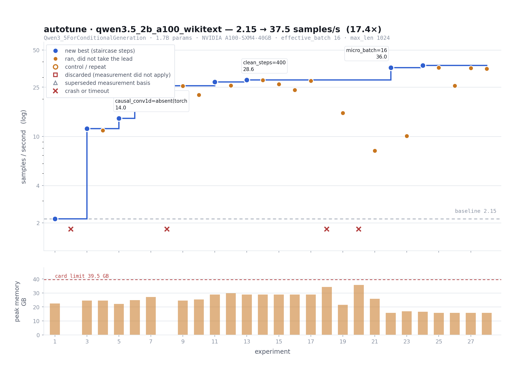

<h1 align="center">autotune</h1>

<p align="center"><b>An autoresearch loop for maximizing training throughput.</b></p>

**The idea:** instead of painstakingly running through configurations, give your agent a training
job and a GPU and let it optimize your training throughput. 

<p align="center">
  
</p>

It profiles a real training step, works out where the time goes, changes one setting,
measures again on the GPU, keeps or discards, and repeats. You wake up to a log of experiments and
a faster config. The run above took Qwen3.5-2B on an A100 from 2.15 to 37.5 samples/s.


## How it works

```
 ┌───────────┐     ┌────────────┐     ┌────────────────────────┐     ┌───────────────────┐
 │   Frame   │ ──▶ │  Baseline  │ ──▶ │          Loop          │ ──▶ │       Learn       │
 │  size up  │     │  run your  │     │   change one thing,    │     │  record the run,  │
 │  the job  │     │   config   │     │  test, keep if faster  │     │   update beliefs  │
 └───────────┘     └────────────┘     └───▲────────────────┬───┘     └───────────────────┘
                                          │     repeat     │
                                          └────────────────┘
```

## Quick start

**Requirements:** a single NVIDIA GPU (local or over SSH), Python 3.11–3.13, [uv](https://docs.astral.sh/uv/).

```bash
git clone https://github.com/NanoNets/autotune && cd autotune
uv sync
uv run pytest
```

## Running the agent

Activate the environment first, then open the repo in [Claude Code](https://claude.com/claude-code). The agent calls `python` directly, so it must resolve to the project's `.venv`:

```bash
source .venv/bin/activate
set -a; source .env; set +a      # copy .env.example to .env first; nothing else loads it
claude
```

The bundled skill, [`.claude/skills/run-loop/SKILL.md`](.claude/skills/run-loop/SKILL.md), takes the whole run in one command.

<h3 align="center">Two User Workflows</h3>

```
                     Do you have your own training script?
                  ┌────────────────────┴────────────────────┐
                  no                                        yes
                  ▼                                         ▼
   ┌─────────────────────────────┐           ┌─────────────────────────────┐
   │  A. Use our default script  │           │  B. Bring your own script   │
   │                             │           │                             │
   │  leave out script=          │           │  add script=<path>          │
   │  hf.py    → HF causal LM    │           │  (+ script_configs=<path>)  │
   │  torch.py → tiny MLP over   │           │  runs as-is; your files are │
   │             random data     │           │  never modified             │
   └──────────────┬──────────────┘           └──────────────┬──────────────┘
                  └────────────────────┬────────────────────┘
                                       ▼
             Frame → Baseline → Loop → Learn  (identical for both)
                                       ▼
               runs/<run_name>/: experiment log + faster config
```

```
/run-loop <run_name>
    model=<hf_id>                    # e.g. Qwen/Qwen2.5-0.5B
    dataset=<hf_id>[:<config>]       # e.g. Salesforce/wikitext:wikitext-2-raw-v1
    max_len=<N>                      # sequence length, never changed
    effective_batch=<N>              # batch size, never changed
    host=<user>@<ip> | local         # where experiments run
    gpu=<label>                      # e.g. A10
    [script=<path>]                  # optional: your own training script
    [script_configs=<path>,...]      # optional: the config files it loads
    [resume | review | smoke]        # optional: continue / write up / CPU dry run
```


| Argument                      | Meaning                                                                                      |
| ----------------------------- | -------------------------------------------------------------------------------------------- |
| `model`, `dataset`            | Hugging Face ids (`:config` picks a dataset subset)                                          |
| `max_len`, `effective_batch`  | your training's sequence length and batch size; never changed                                |
| `host` / `local`              | where experiments run: a GPU box over SSH, or this machine                                   |
| `gpu`                         | a label for the record (the peak is measured on the card)                                    |
| `script`, `script_configs`    | tune your own training script (and the config files it loads) instead of the built-in runner |
| `resume` / `review` / `smoke` | continue a stopped run / write up a finished one / a CPU dry run                             |


For example:

```
# A. our default script
/run-loop my_run model=Qwen/Qwen2.5-0.5B dataset=Salesforce/wikitext:wikitext-2-raw-v1 \
          max_len=2048 effective_batch=16 host=ubuntu@<gpu-box> gpu=A10

# B. your own script (and the YAML it loads)
/run-loop my_byo_run model=HuggingFaceTB/SmolLM2-360M host=ubuntu@<gpu-box> gpu=A10 \
          script=examples/byo_script/trainer_yaml.py script_configs=examples/byo_script/train.yaml
```

Script paths are relative to the repo root. See [`examples/byo_script/`](examples/byo_script/) for scripts that work with path B.

## Our contributions

- **Measured, not assumed.** The card's peak FLOP/s and bandwidth are benchmarked on the device,
so MFU is right on any GPU. Every comparison uses the same data rows and the same instrument, and
impossible readings are thrown out.
- **A memory ceiling that's measured.** Real batches rarely hit the maximum length, so a config can
pass every test and crash hours into training. autotune runs worst-case batches up front, and
re-checks whenever a memory setting changes.
- **A memory that compounds.**

```
    run N                          shared memory                        run N+1
 ┌─────────┐  writes a record   ┌──────────────────┐   run before?    ┌─────────┐
 │  frame  │ ─────────────────▶ │ experience/      │ ───────────────▶ │  frame  │
 │  probe  │                    │ indexed record   │  replay a match  │  probe  │
 │  learn  │                    │ of every run     │                  │  learn  │
 │         │  confirms, splits  ├──────────────────┤ priors for each  │         │
 │         │  or deletes claims │ beliefs/         │    hypothesis    │         │
 │         │ ─────────────────▶ │ evolving claims  │ ───────────────▶ │         │
 └─────────┘                    └──────────────────┘                  └─────────┘
```


## Project structure

```
program.md     agent instructions
frame/         sizes up the job, measures the memory ceiling
profiler/      measures each experiment
backends/      where experiments run: local, ssh
frameworks/    the built-in Hugging Face runner
beliefs/       shared beliefs from past runs
experience/    one record per past run
examples/      example training scripts to tune
loop/          design notes and data contracts
```


## Platform support
**Training Methods**: SFT, PEFT

**Models**: LLMs, VLMs (MoE's are out of scope for now)

**HW Support**: Single NVIDIA GPU
