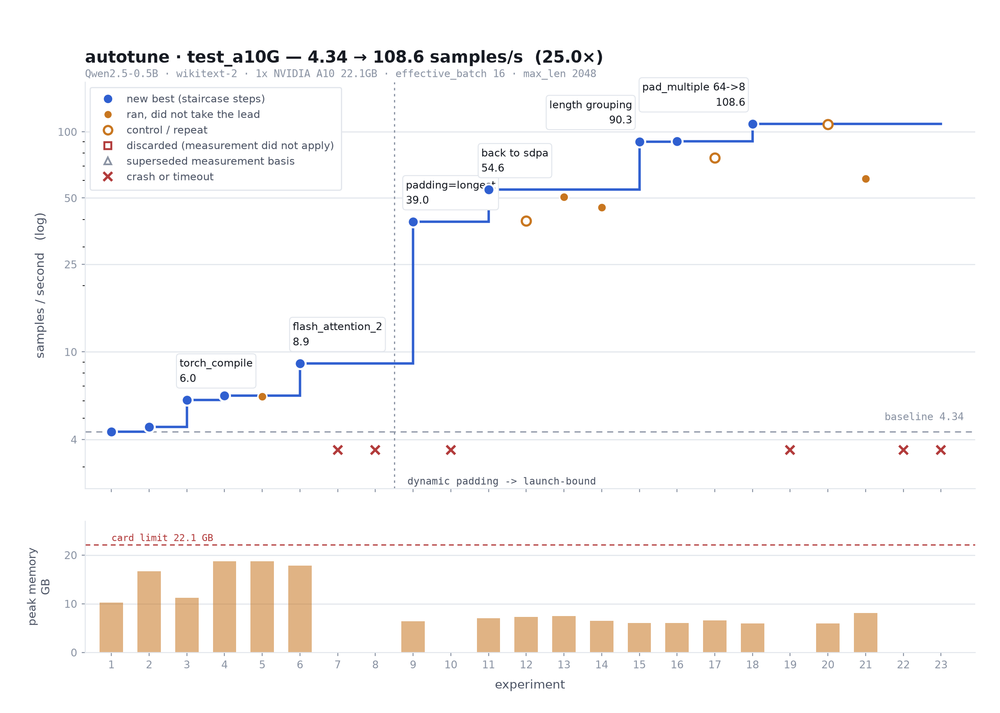

<h1 align="center">autotune</h1>

<p align="center">
  
</p>

The idea: give an AI agent your training job and a GPU, and let it find the fastest configuration
overnight. It profiles a real training step, works out where the time goes, changes one setting,
measures again on the GPU, keeps or discards, and repeats. You wake up to a log of experiments and
a faster config. The run above took Qwen2.5-0.5B on an A10 from 4.3 to 108.6 samples/s.

The agent only touches settings that change **speed** (micro-batch, attention kernel, compile,
gradient checkpointing, padding, dataloader). Learning rate, precision, effective batch and sequence
length are off-limits, so a faster config is never a worse model.

## How it works

- **`program.md`**: the agent's instructions, step by step. Point your agent here.
- **`frame/` + `profiler/`**: the measurement code. Frame sizes up the job once (model, dataset,
  the card's real peak, the largest micro-batch that fits); the profiler measures each experiment
  and returns a diagnostic the agent reads (MFU, GPU-active time, data-wait, kernels, memory).
- **`beliefs/` + `experience/`**: what earlier runs learned. The agent starts from it and writes
  back to it.

The agent decides what to try; the code does all the measuring.

## Quick start

**Requirements:** a single NVIDIA GPU (local, over SSH, or on Modal), Python 3.11+,
[uv](https://docs.astral.sh/uv/).

```bash
git clone https://github.com/NanoNets/autotune && cd autotune
uv sync
uv run pytest
```

## Running the agent

Open the repo in [Claude Code](https://claude.com/claude-code) and use the bundled skill:

```
/run-loop my_run model=Qwen/Qwen2.5-0.5B dataset=Salesforce/wikitext:wikitext-2-raw-v1 \
          max_len=2048 effective_batch=16 host=ubuntu@<gpu-box> gpu=A10
```

It sizes up the job, shows you a summary to confirm, then runs unattended until you stop it.
Results land in `runs/my_run/`. To tune **your own training script** (HF Trainer, TRL, a plain
PyTorch loop) instead, add `script=path/to/train.py`; it runs unchanged. See
[`examples/byo_script/`](examples/byo_script/). Later, `/run-loop my_run resume` picks up where it
stopped.

No Claude Code? Fill in `run.toml` and point any coding agent at `program.md`.

## Our contributions

- **Measured, not assumed.** The card's peak FLOP/s and bandwidth are benchmarked on the device,
  so MFU is right on any GPU. Every comparison uses the same data rows and the same instrument, and
  impossible readings are thrown out.
- **A memory ceiling that's measured.** Real batches rarely hit the maximum length, so a config can
  pass every test and crash hours into training. autotune runs worst-case batches up front, and
  re-checks whenever a memory setting changes.
- **A memory that compounds.** `experience/` keeps one record per run; `beliefs/` keeps claims like
  "tf32 does nothing under bf16", each tied to the model family, card and data it was proven on.
  The next run starts from them, and contributing what your run learned is a pull request.

## Project structure

```
program.md     agent instructions
frame/         sizes up the job, measures the memory ceiling
profiler/      measures each experiment
backends/      where experiments run: local, ssh, modal
frameworks/    the built-in Hugging Face runner
beliefs/       shared beliefs from past runs
experience/    one record per past run
examples/      example training scripts to tune
loop/          design notes and data contracts
```

## Platform support

Single NVIDIA GPU for now. Multi-GPU and a learned model that ranks candidates are next.
